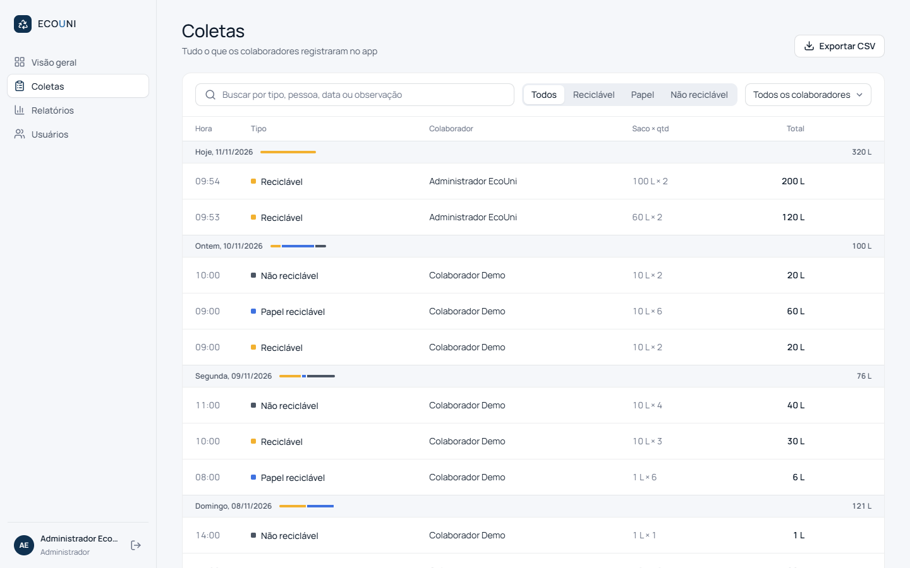
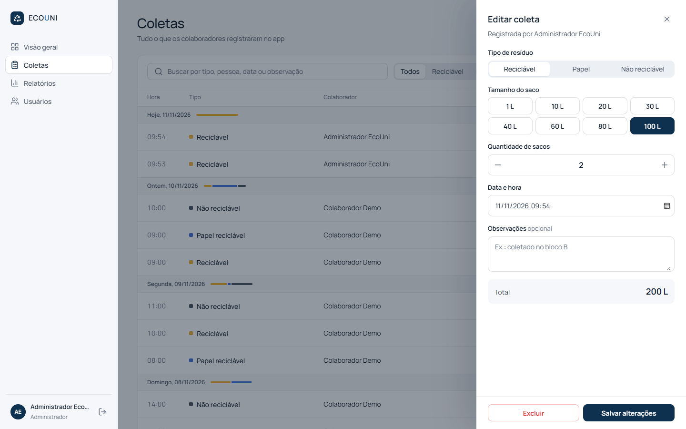

# EcoUni Web

Painel administrativo do EcoUni, o sistema de registro de coletas de resíduos de um campus universitário. Os colaboradores registram as coletas pelo [app](https://github.com/kaiquedu/ecouni-mobile), e o administrador acompanha tudo por aqui. Os dados vêm da [API](https://github.com/kaiquedu/ecouni-backend).

Faz parte do Projeto de Conclusão de Curso do **Centro Universitário UNIFAAT**. O painel substitui o site MVC da versão original.


## O que tem

O acesso é só do administrador. Colaboradores que tentam entrar recebem um aviso para usar o app.

- **Visão geral**: volume, percentual reciclado, coletas do dia e colaboradores ativos em 7 dias, 30 dias ou no mês, com gráfico diário por tipo, ranking de quem mais coletou e últimas coletas.
- **Coletas**: tabela agrupada por dia, com busca, filtro por tipo e colaborador, edição em painel lateral, exclusão e exportação em CSV.
- **Relatórios**: filtros de período (inclusive intervalo personalizado), tipo e colaborador, indicadores, gráfico por dia, semana ou mês e exportação em PDF ou CSV.
- **Usuários**: contas com número de coletas, volume e data da última coleta de cada pessoa, cadastro de colaboradores e exclusão.

<p>
  
  
</p>
<p>
  
  
</p>

## Stack

- React 19 + Vite, em JavaScript, a mesma linguagem do app
- React Router, com as páginas do painel carregadas sob demanda
- jsPDF para o relatório, carregado só na hora de exportar
- Manrope (via Fontsource, servida localmente) e ícones Lucide
- CSS próprio, com as cores dos tipos de resíduo iguais às do app

Não há biblioteca de gráficos nem de componentes. As barras, o seletor, o painel lateral, os diálogos e as animações são feitos à mão. As animações são desligadas quando o sistema pede movimento reduzido.

## Como rodar

Pré-requisitos: Node 20+ e a [API](https://github.com/kaiquedu/ecouni-backend) rodando, que sobe com `docker compose up`.

```bash
npm install
cp .env.example .env
npm run dev
```

O painel abre em http://localhost:5173. O `.env` aponta para a API em `http://localhost:5000`, e o docker-compose da API já libera essa origem no CORS.

Na tela de login, o botão **Preencher** usa a conta de demonstração (`admin@ecouni.dev`, senha `Demo@123`).

| Script | O que faz |
|---|---|
| `npm run dev` | Servidor de desenvolvimento |
| `npm run build` | Build de produção em `dist/` |
| `npm run preview` | Serve o build em http://localhost:4173 |
| `npm run lint` | Oxlint |

## Estrutura

```
src/
  components/   UI compartilhada, layout, gráfico de barras e painel de edição de coleta
  context/      Sessão do admin, lista de coletas, toast e diálogo de confirmação
  lib/          Cliente da API, formatação, filtros de relatório, PDF e CSV
  pages/        Login, visão geral, coletas, relatórios e usuários
```
