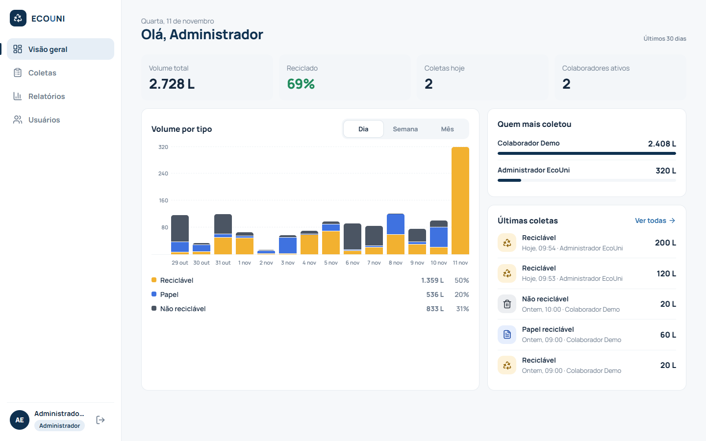
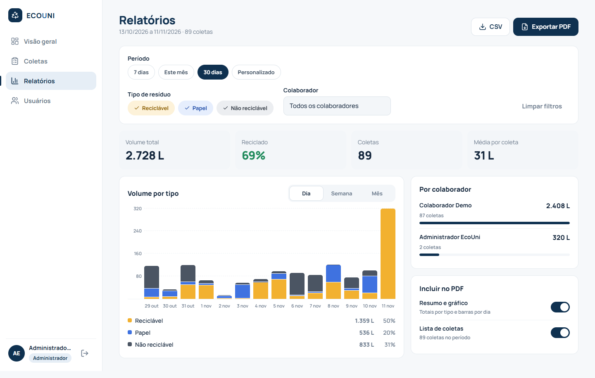
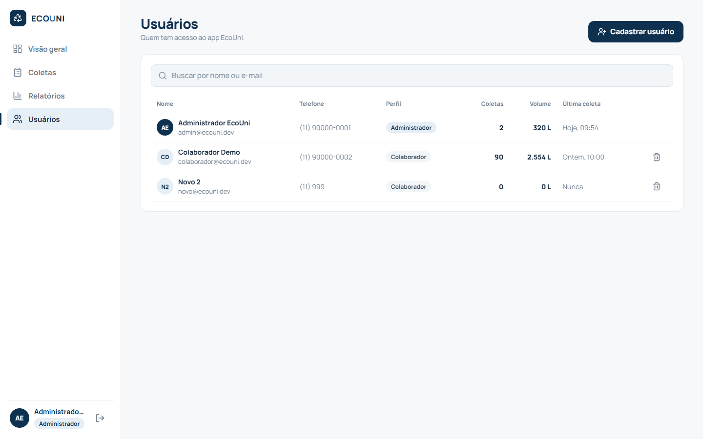

# EcoUni Web

Landing page e painel administrativo do EcoUni, o sistema de registro de coletas de resíduos de um campus universitário. Os colaboradores registram as coletas pelo [app](https://github.com/kaiquedu/ecouni-mobile), e o administrador acompanha tudo por aqui. Os dados vêm da [API](https://github.com/kaiquedu/ecouni-backend).

Faz parte do Projeto de Conclusão de Curso do **Centro Universitário UNIFAAT**. O painel substitui o site MVC da versão original.



## O que tem

**Landing page** (`/`): apresenta o sistema, explica o fluxo em três passos e mostra os tipos de resíduo, os recursos e prints do app.

**Painel** (`/painel`), só para o administrador. Colaboradores recebem um aviso e são direcionados ao app.

- **Visão geral**: volume dos últimos 30 dias, percentual reciclado, coletas do dia, gráfico por dia, semana ou mês, ranking de colaboradores e últimas coletas.
- **Coletas**: tabela com busca, filtros por tipo e colaborador, paginação, edição em painel lateral, exclusão e exportação em CSV.
- **Relatórios**: filtros de período, tipo e colaborador, indicadores, gráfico de barras empilhadas e exportação em PDF ou CSV.
- **Usuários**: lista com número de coletas, volume e data da última coleta de cada pessoa, cadastro de colaboradores e exclusão de contas.

<p>
  
  
</p>
<p>
  
  
</p>

## Stack

- React 19 + Vite, em JavaScript, a mesma linguagem do app
- React Router, com as páginas do painel carregadas sob demanda
- jsPDF para o relatório, carregado só na hora de exportar
- Manrope (via Fontsource, servida localmente) e ícones Lucide
- CSS próprio, com os mesmos tokens de cor, raio e tipos de resíduo do app

Não há biblioteca de gráficos nem de componentes. As barras, o seletor, os diálogos e as animações são feitos à mão. As animações são desligadas quando o sistema pede movimento reduzido.

## Como rodar

Pré-requisitos: Node 20+ e a [API](https://github.com/kaiquedu/ecouni-backend) rodando, que sobe com `docker compose up`.

```bash
npm install
cp .env.example .env
npm run dev
```

O painel abre em http://localhost:5173. O `.env` aponta para a API em `http://localhost:5000`, e o docker-compose da API já libera essa origem no CORS.

Para entrar, use a conta de demonstração `admin@ecouni.dev` com a senha `Demo@123`.

| Script | O que faz |
|---|---|
| `npm run dev` | Servidor de desenvolvimento |
| `npm run build` | Build de produção em `dist/` |
| `npm run preview` | Serve o build em http://localhost:4173 |
| `npm run lint` | Oxlint |

## Estrutura

```
src/
  components/   UI compartilhada, layout do painel, gráfico e painel de edição
  context/      Sessão do admin, lista de coletas, toast e diálogo de confirmação
  lib/          Cliente da API, formatação, filtros de relatório, PDF e CSV
  pages/        Landing, login e as quatro telas do painel
public/
  screens/      Prints do app usados na landing
```
